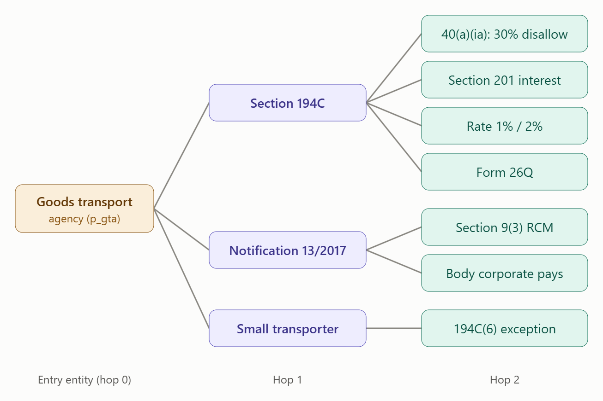

# ⚖️ Regulatory GraphRAG: GST and Income-tax compliance Q&A

A GraphRAG system that ingests Indian GST and Income-tax provisions into a **knowledge graph** and answers
compliance scenarios **only** from graph facts and statute text. Every claim carries a citation, and a
guardrail checks each answer for hallucinated sections. **Total running cost: ₹0.**

| Layer | Tool | Cost |
|---|---|---|
| Knowledge graph | NetworkX (default) or Neo4j Community (Desktop / Docker) | Free |
| Embeddings | `sentence-transformers/all-MiniLM-L6-v2`, runs locally | Free |
| LLM | Groq free tier, **or** Ollama for a fully local Llama 3 | Free |
| UI | Streamlit + pyvis graph visualisation | Free |

> **Model note (Nov 2026):** Groq's deprecation page says the Llama 3.x models (`llama-3.3-70b-versatile`,
> `llama-3.1-8b-instant`) were shut down on the free tier on 16 Aug 2026. Groq recommends `openai/gpt-oss-120b`
> as the replacement, which is an open-weight model. The app reads a **preference list** (`GROQ_MODELS`) and uses
> the first model your key can access, so a model being retired won't break it. To use *Llama 3* specifically,
> set `LLM_PROVIDER=ollama`, which runs it on your own machine.

---

## 1. Local setup (Windows / macOS / Linux)

**Prerequisites:** Python 3.10–3.12, about 2 GB of free disk space (PyTorch + model), and internet access for the first run.

```bash
# 1. get the code
cd regulatory-graphrag

# 2. virtual environment
python -m venv .venv
# Windows:  .venv\Scripts\activate
# mac/linux: source .venv/bin/activate

# 3. (optional, saves ~1.5 GB) CPU-only PyTorch first
pip install torch --index-url https://download.pytorch.org/whl/cpu

# 4. everything else
pip install -r requirements.txt

# 5. config
cp .env.example .env          # Windows: copy .env.example .env
#   -> open .env and paste your Groq key (free: https://console.groq.com/keys)
```

### Build the graph and run the UI
```bash
python ingest.py build        # seed graph + rule extraction (no API calls; first run downloads MiniLM ~90 MB)
streamlit run app.py          # opens http://localhost:8501
```
Try the example scenarios in the **Ask** tab, then compare the two approaches in the **GraphRAG vs RAG** tab.

### Terminal usage (handy while teaching)
```bash
python ingest.py stats
python ingest.py ask "Can we claim ITC on GST paid for a company car?"
python ingest.py compare "We pay a GTA for freight. What GST and income-tax compliance applies?"
python ingest.py build --llm           # also run LLM extraction on every chunk (spends Groq quota)
python ingest.py add path/to/circular.pdf
pytest -q                              # offline tests: no key and no internet needed
```

---

## 2. Optional: switch to Neo4j

**Option A, Neo4j Desktop:** install it from neo4j.com/download, create a project, then **Add → Local DBMS**
(any 5.x version) with password `password123`, and press **Start**.
**Option B, Docker:** `docker compose up -d`

Then set the backend in `.env`:
```
GRAPH_BACKEND=neo4j
NEO4J_PASSWORD=password123
```
Rebuild with `python ingest.py build`. You can now:
* open the Neo4j Browser (http://localhost:7474) and run `MATCH (n:Entity)-[r]->(m) RETURN n,r,m LIMIT 200`
* use the **Text2Cypher** tab, where the LLM writes Cypher and the app blocks anything that isn't read-only

## 3. Optional: fully local Llama 3 with Ollama
```bash
# install from https://ollama.com, then:
ollama pull llama3.1:8b
```
`.env` → `LLM_PROVIDER=ollama`. Nothing leaves your machine: no API key and no rate limits.
It is slower on CPU, and an 8B model follows the citation rules less strictly than gpt-oss-120b.

---

## 4. Architecture

```
data/raw/*.txt|pdf
   │  loaders.py      provision-aware chunking (1 chunk = 1 Section)
   ▼
extractor.py ──► (1) seed_triples.json   expert-curated, deterministic
              ├► (2) regex rules          "Section 16(2)" → REFERS_TO, "GSTR-3B" → REQUIRES_FORM
              └► (3) LLM (optional)       JSON restricted to the ontology in schema.py
   ▼
store/  NetworkX | Neo4j      +   embeddings.py  VectorIndex (MiniLM, numpy cosine)
   ▼
pipeline.py  ask(question)
   1. link_entities   regex refs + semantic match on entities + best-matching provision
   2. expand          k-hop BFS from those nodes (skips hub "Act" nodes)  → facts F1..Fn
   3. evidence        statute text of the provisions reached           → sources S1..Sn
   4. LLM answers ONLY from F/S, cites every claim
   5. grounding_check  invalid citations? sections not in context? citation coverage?
   ▼
app.py  Streamlit: Ask | GraphRAG vs RAG | Explore | Text2Cypher | Add docs | How it works
```

### File map
| File | What to explain to students |
|---|---|
| `graphrag/schema.py` | The **ontology**: 8 node types and 15 relation types. Deterministic IDs give free entity resolution. |
| `graphrag/loaders.py` | Why legal text is chunked by provision rather than by a fixed number of characters. |
| `graphrag/extractor.py` | The three extraction layers, and why the LLM is restricted to the schema. |
| `data/seed_triples.json` | What a domain expert contributes: `RESTRICTS`, `EXCEPTION_TO`, `CONSEQUENCE_OF` edges. |
| `graphrag/store/*` | One interface with two databases. Compare the BFS in Python with variable-length Cypher. |
| `graphrag/embeddings.py` | A local MiniLM model and a 30-line vector index. No paid vector DB is needed. |
| `graphrag/pipeline.py` | Retrieval, the prompt, the guardrail, the plain-RAG baseline, and Text2Cypher. |
| `graphrag/llm.py` | Provider abstraction, model auto-selection, 429 back-off, and robust JSON parsing. |
| `app.py` | The UI, plus visualising the reasoning sub-graph. |

---

## 5. Teaching demo script (≈20 min)

1. **Explore tab** → centre on *Section 16*. Show `Section 17(5) -RESTRICTS-> Section 16`. The graph records
   that one provision overrides another; a vector index has no way to represent that.
2. **Compare tab** with *"We pay a Goods Transport Agency for freight. What GST and income-tax compliance applies?"*
   * Plain RAG usually finds Notification 13/2017 (RCM) but **misses** that RCM forces registration under Section 24,
     and misses the income-tax side (194C → 194C(6) small-transporter exception → 40(a)(ia) 30% disallowance).
   * GraphRAG walks `GTA → Notification 13/2017 → Section 9(3) ← Section 24` **and** `GTA ← 194C → 40(a)(ia)`.
     This is the multi-hop, cross-Act reasoning that plain RAG misses.
3. **Hallucination test:** ask *"What does Section 80C say about GST?"*. The context holds nothing on it, so the model
   should reply "Not found in the knowledge graph". If a model invents an answer anyway, the guardrail flags the section.
4. **Ingest tab:** upload a real CBIC circular PDF with LLM extraction on, then watch the node count grow.

### Student exercises
1. Add the IGST Act's place-of-supply sections to `data/raw/` and add `PLACE_OF_SUPPLY` edges.
2. Add `valid_from` / `valid_to` properties to edges so the graph can answer "what was the rule in FY 2021-22?".
   The Section 16(4) and 194J threshold amendments are good test cases.
3. Map the Income-tax Act 1961 sections to their Income-tax Act 2025 equivalents with `REPLACES` edges.
4. Build an evaluation set of 20 Q&A pairs and measure citation coverage and accuracy for plain RAG vs GraphRAG.
5. Swap the BFS for Personalized PageRank (`networkx.pagerank(personalization=...)`) and compare the results.

---

## 6. Troubleshooting
| Symptom | Fix |
|---|---|
| `GROQ_API_KEY missing` | Put the key in `.env`, then restart Streamlit. |
| `None of [...] available` | The error lists the models your key can see; copy one into `GROQ_MODELS`. |
| 429 / rate limit | Wait a minute. Use `openai/gpt-oss-20b` (higher limits), or switch to Ollama. |
| Can't download MiniLM (firewall) | Set `EMBED_MODEL=hash` (weaker offline fallback) or copy the model folder manually. |
| Neo4j `ServiceUnavailable` | The DBMS isn't running, or the URI/password in `.env` is wrong. |
| Changed code but UI unchanged | Stop Streamlit (Ctrl+C) and start it again. Imported modules are cached. |

## ⚠️ Disclaimer
`data/raw/` holds **plain-language teaching summaries**, not the bare Acts. Thresholds and rates change through
Finance Acts and notifications, and the Income-tax Act 2025 replaces the 1961 Act from 1 April 2026.
Load official texts from cbic-gst.gov.in / incometaxindia.gov.in for real use. The outputs are educational and are not tax advice.


-----------------DATA-----------------------------
Relation	Plain meaning
PART_OF	Sits inside (Section 16(4) is part of Section 16)
DEFINES / GOVERNS	This section is the rule for that concept
APPLIES_TO	Who it hits
REFERS_TO	Mentions another section
EXCEPTION_TO	Overrides another rule
RESTRICTS	Limits something (blocked credits restrict ITC)
CONSEQUENCE_OF	What happens if you break that rule (penalties, interest)
HAS_THRESHOLD	Its number, rate or limit
REQUIRES_FORM	What you have to file
NOTIFIED_UNDER / AMENDS / REPLACES	Legal history links
LIABLE_UNDER	Who has to pay




python ingest.py build                 # 1. build the graph, no API key needed
python ingest.py stats                 # 2. see what got built
python ingest.py ask "We paid a transporter Rs 2 lakh freight and did not deduct TDS. What is the impact?"
python ingest.py compare "We paid a transporter Rs 2 lakh freight and did not deduct TDS. What is the impact?"
python ingest.py build --llm           # 3. optional: richer graph using the LLM.